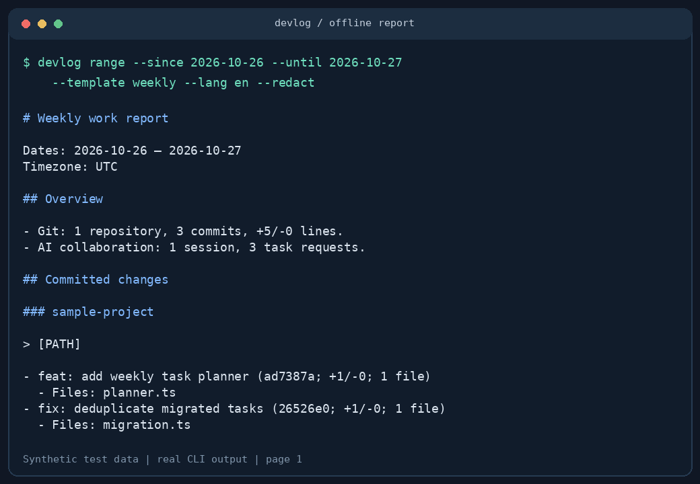

# devlog

**Turn Git commits and AI coding sessions into evidence-based daily and weekly reports.**

Offline by default · Zero runtime dependencies · Codex CLI / Claude Code · Chinese / English · MIT

[中文](README.md) · [Example report](docs/example-weekly.en.md) · [Contributing](CONTRIBUTING.md)

[](https://github.com/qianqian777899/devlog/actions/workflows/ci.yml)



Git remembers commits. AI tools remember requests. `devlog` brings both into a Markdown work log, without pretending a request is a finished result.

> v0.1.0 is available from GitHub source. It has **not been published to the npm registry**. The intended package name is `@qianqian777899/devlog`; the executable is `devlog`. Do not run `npx devlog`: that name may belong to someone else.

## Install

Requires **Node.js 20+** and **Git**. Supports Linux, macOS and Windows.

```sh
npm install --global github:qianqian777899/devlog
devlog init
devlog today --lang en --redact
```

Or build from source:

```sh
git clone https://github.com/qianqian777899/devlog.git
cd devlog
npm ci
npm run build
node dist/cli.js week --root /path/to/projects --lang en
npm link # optional: register the devlog command
```

## Usage

```sh
devlog today --root ~/code --email me@example.com --lang en
devlog week --template weekly --redact --output weekly.md
devlog range --since 2026-10-19 --until 2026-10-25 --lang en
devlog week --template okr --lang en
devlog today --no-sessions
devlog week --all-authors
devlog --help
```

- Repeat `--root` and `--email` to supply multiple values, replacing config values.
- `today` is the local calendar day. `week` runs from Monday through today. `TZ` can set the process timezone.
- Date-only `--until` is inclusive. ISO timestamps require a timezone offset and use an exclusive upper bound.
- Exact, case-insensitive author email filtering defaults to each repository's `git config user.email`. A missing email skips that repository with a warning. `--all-authors` opts into all Git authors; session attribution is directory-based.
- Reports go to stdout; warnings to stderr. Use `--force` to overwrite output files. Output parent directories must exist.
- `--template daily|weekly|okr`; `--lang zh|en`. OKR targets and unknown outcomes remain placeholders.

## Configuration

`devlog init` interactively writes `~/.config/devlog/config.json`. Use `init --yes` for defaults and `--force` to overwrite. Without a config, the current directory is the scan root. `--config FILE` selects a different file.

See [config.example.json](docs/config.example.json). Use absolute paths or `~/...`; relative paths resolve from the current working directory. Set `codexPath` / `claudePath` to `null` to disable that source.

## Optional AI polishing

Only `--ai` enables network access. It sends the **generated, redacted report** to your chosen provider. No telemetry is built in. Review whether your provider and content are appropriate for your project before enabling it.

```sh
export DEVLOG_API_KEY="your-key"
export DEVLOG_BASE_URL="https://your-provider.example/v1"
export DEVLOG_MODEL="your-model-id"
devlog week --ai --lang en --redact
```

In PowerShell use `$env:DEVLOG_API_KEY = "your-key"` and the same syntax for the other variables.

Configuration may provide `ai.baseURL`, `ai.model`, and `ai.apiKeyEnv` (default `DEVLOG_API_KEY`). Environment variables override config. Inline `ai.apiKey` is supported, but environment variables are recommended.

The request uses `POST {baseURL}/chat/completions`. Providers must implement the OpenAI-compatible chat completion protocol; provider-specific extensions and authentication are outside this MVP. Set a model ID actually supported by your provider.

External endpoints require HTTPS. Localhost HTTP is allowed with no key required. Redirects are rejected. Requests time out after 60 seconds, input is capped at 100,000 characters, and responses at 2 MiB. AI failure keeps the offline report with a warning (exit 0). Command, config and file-write errors exit 1. AI output is explicitly marked as a draft.

## Evidence and privacy limits

| Source | Included | Not implied / included |
| --- | --- | --- |
| Git | Non-merge commits reachable from `HEAD`, filtered by author timestamp, including unpushed commits | Deployment, other branches, stash, uncommitted changes, bare repositories |
| Codex | In-period user requests and recognized file tool references | Successful completion, shell output, reasoning, source file contents |
| Claude Code | In-period user text and recognized file tool references | Tool results, meta messages, assistant completion claims, reasoning |

- Session `cwd` must fall under a configured root; missing `cwd` is skipped. Cross-day sessions are filtered per event, not by file creation time. Deleted project paths can still be attributed from an absolute recorded `cwd`.
- Codex paired turn channels and Claude UUID/tool IDs are deduplicated. Distinct worktree paths count as separate repositories and may repeat commits.
- Renames count as deletion plus addition; binary files have no line count. Line totals are cumulative changes, not a productivity measure.
- Unknown formats, malformed JSONL and records over 2 MiB are skipped with warnings. Missing default session directories are normal. Directory scans stop at 100,000 entries, skip symlinks and common dependency/build/cache directories. Git calls have 30-second / 32 MiB limits; failures skip the repository with a warning.
- User request summaries are capped at 240 characters and may still contain secrets. No commands from session logs are executed.
- `--redact` masks common credentials, private keys and absolute paths in reports and warnings. Exact configured roots are handled even with spaces; other paths with spaces and unknown credential formats may escape detection. Inspect before sharing.
- AI requests are always redacted before transmission, even without `--redact`. **Redaction is best-effort; AI mode still uploads data.**

See [adapter notes and format references](docs/adapters.md).

## Development

```sh
npm ci
npm run check
npm pack --dry-run
```

Vitest tests create temporary Git repositories and synthetic JSONL fixtures. They cover author and date filters, worktrees, renames, malformed logs, duplicate turns, redaction, CLI behavior, offline operation and AI failure fallback. CI tests Node 20 / 22 / 24 on Linux and Windows.

`dist/` is tracked so GitHub installations work without a build toolchain. Run `npm run build` and include its changes when editing source. See [RELEASING.md](RELEASING.md) for the owner-operated npm release process.

## Roadmap

- [ ] Cursor and Gemini CLI adapters
- [ ] Configurable excluded paths and custom redaction rules
- [ ] Explicitly authorized Feishu / DingTalk exports
- [ ] VS Code extension

All examples, fixtures and demo data are synthetic. Please submit only anonymized logs in issues.

## License

[MIT](LICENSE) © 2026 qianqian777899
